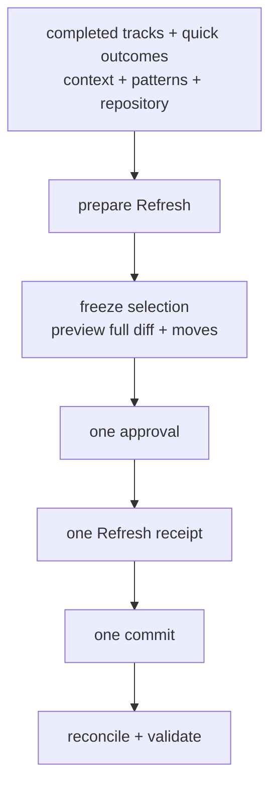

# Workflow Guide

Cadre exposes ten workflows in all supported clients. In Codex use
`$cadre:<skill>`; in Claude Code use `/cadre:<skill>`; in the Zed Agent use
`/cadre-<skill>`.

## create

Use `create` to initialize or resume Cadre in a project repository.

The workflow:

1. Resolves the exact repository root and Git disposition.
2. Classifies the project as greenfield or brownfield with evidence.
3. Drafts product, guidelines, technology, workflow, styleguide, pattern, and
   state artifacts from versioned templates.
4. Identifies bundled workflow/styleguide defaults concisely and asks only
   about unresolved material choices.
5. Presents one complete initialization authorization envelope.
6. Promotes initialization with journaled recovery after approval of its prepare digest.
7. Initializes Git when included in that envelope and no repository exists.
8. Validates, commits, and records provenance without follow-up approvals.

An existing `.cadre/project.json` is resumed, never overwritten.

## quick

Use `quick` for one bounded, locally verifiable fix, refactor, documentation
change, test, or small feature. A clear request authorizes reversible edits;
material choices or wider consequences get a scope discussion first. Quick
reads relevant project context, verifies and reviews the change, and asks for
one final approval. One local commit includes code, the immutable outcome
record, and its receipt. There is no track, phase graph, separate review commit,
or per-change archive step.

Interrupted work remains in ignored staging. Status shows quick outcomes
separately from tracks. An approved refresh batch assesses at most 20 outcomes,
merges durable findings into existing guidance or patterns, reassesses affected
active-track memory, and moves original records unchanged to
`.cadre/archive/.quick/`. Track context includes no quick history by default;
focused search and selected IDs retrieve relevant records, including archives. Quick does not run beside active
Cadre workers or absorb pre-existing edits. Migrations, coordinated work, and
changes to approved track requirements go through track or revise.

Existing v5/v6 projects need a one-time approved refresh adopting the current quick
contract. Installation alone does not rewrite project policy.

## track

Use `track` for a new feature or bug. A clear track defaults to one combined
approval covering:

- Specification: scope, requirements, acceptance criteria, additional
  information, track dependencies, and dependent-track impact.
- Plan: phase/task dependency graph plus the relevant Pattern Seed in
  `learning.md`.

Cadre asks when feature versus bug, scope, interfaces, compatibility,
acceptance, or dependencies remain materially ambiguous. A drafting track is
resumed rather than replaced. V5 specification, plan, learning, state and dependency context share one
approved commit and immutable operation receipt. The human can explicitly request staged spec/plan review.

## implement

Use `implement` for `planned` or `in_progress` tracks.

Parallel execution is the default, but workers are created only when at least
two safe nodes are ready. Main allocates one global worker bound across active
phases and their phase-local task waves; an individual phase can move between a
sequential worker and task fan-out only at a clean checkpoint. Explicit
sequential mode avoids worker worktrees. Declared track dependencies must
already be completed or archived after completion.

Approval mode is independent of parallel/sequential scheduling:

- `governed` presents each regular task and material integration transition;
- `phase` runs a phase autonomously until its final User Manual Verification task;
- `track` is the default and pauses at Track-level User Manual Verification and ordinary review approval;
- `autonomous` implements, verifies, reviews, and fixes in-scope findings until clean, then asks for one final completion approval.

The `implement` invocation authorizes execution start with the requested modes
or their defaults. `phase`, `track`, and `autonomous` do not add a separate start prompt.
All modes stop for material ambiguity, scope divergence, unsafe state, or a
required-check exception. Track-level verification requires the human in Governed,
Phase, and Track; Autonomous records actual verification under persisted authority.
Execution finish moves the track to `ready_for_review`, never directly to
`completed`. In Autonomous this is an internal handoff: after committing
implementation bookkeeping, the agent invokes review through MCP `nextStep`
and continues fixes → verification → cumulative review until clean.

## review

Use `review` for `ready_for_review` tracks or to recover a journaled Autonomous
review operation from `in_progress`.

The reviewer inspects the recorded implementation range, affected callers,
tests, error paths, security boundaries, compatibility, requirements, and
learning. Findings are presented before they enter state.

- Approved findings create exact bug/remediation artifacts and return the track
  to implementation.
- Changed desired behavior is routed to `revise`, not recorded as a defect.
- An approved clean review binds evidence to the current execution, plan
  revision, graph digest, and reviewed HEAD, then marks the track `completed`.

Autonomous continues through the same review and remediation procedure using its
persisted authority, retaining findings and reviewing the cumulative implementation.
It pauses when a finding survives two remediation attempts. Final clean completion
still requires explicit human approval. The final summary presents verification,
remediation history, and the exact completion proposal. The author can approve
that proposal without invoking review again, or report additional bugs to
continue remediation. Changed implementation or verification inputs require
renewed checks and review. Only `review` can complete a track.

## revise

Use `revise` when approved desired behavior, scope, requirements, acceptance,
dependencies, or plans change.

Behavior depends on lifecycle state:

| State | Revision behavior |
|---|---|
| `drafting-spec` | Continue the unapproved draft without a revision artifact. |
| `drafting-plan` | Revise an approved spec; continue an unapproved plan normally. |
| `planned` | Revise the approved baseline and remain planned. |
| `in_progress` | Reconcile workers at a safe boundary and preserve completed work. |
| `ready_for_review` | Invalidate readiness and append delivery/verification work. |
| `completed` or `archived` | Keep history immutable and propose a successor track. |

Revisions assess transitive dependent tracks and never erase completed commit
provenance. When partial-work disposition can be assessed in advance, it is
included with all cascading changes in one revision approval.

## refresh

Use `refresh` when project context no longer matches user intent, repository
changes, completed-track learning, or quick outcomes.

It can update product, guidelines, workflow, technology, general styleguide,
language/framework styleguides, patterns, and affected active-track seeds.
Execution-governing changes wait for a safe worker boundary. Cascading track
changes follow `revise` impact analysis but join the same refresh approval
instead of creating separate approval cycles.

Refresh selects all eligible completed tracks in dependency order by default. Explicit track IDs limit the batch; an explicit empty selection excludes track archival. Prepare freezes the selection and shows moves, derived state changes, context and pattern updates together. One approval covers one receipt and commit. No new lessons are required to archive; record a justified no-change assessment. Active dependency references relocate within the same operation, while completed history remains immutable.

Blocked-review retry remains focused and cannot archive tracks or consolidate quick outcomes. New archival on older supported projects requires adopting the v8 workflow contract in the same approved refresh diff. Existing archive journals retain their original recovery authority; unapplied archive proposals must be prepared again through Refresh.

Preparation assesses up to 20 quick outcomes and has no track batch limit.
Approval binds the selected tracks,
source contents, destinations, and required context. Track moves, unchanged
quick-record moves, guidance updates, active dependency references, the refresh
record, and the final track index belong to this one operation. Recovery resumes
the approved operation without expanding its selection or repeating its commit.

## revert

Use `revert` to reverse a Cadre task, phase, or track while preserving history.

Cadre identifies exact task, merge, and phase commits; later overlaps; active
worktrees; learning impact; and dependent work. It proposes safe reverse order
and uses additive `git revert` by default. One clean-path approval also covers
tests, reconciliation, generated state, and provenance. A conflict asks again
only when its resolution introduces a material choice or changes the proposal.

## status

Use `status` for a read-only health and progress report. It validates project
state, reads managed worktrees, and derives active execution status. It reports
checkpoints, operations, dependencies, blockers, review/archive readiness,
uncommitted Cadre state, and the next legal command without normalizing files.

## wisp

Use `wisp` for a lightweight investigation, question, or spike that should not
enter Cadre lifecycle state. Disposable output may live under `.cadre/wisps/`
only when the initialized project already ignores it; otherwise it uses an OS
temporary directory and never creates `.cadre/`. Ordinary exploration has zero approvals. Persistent product
changes should use `quick` when bounded or `track` when coordinated; explicitly requested untracked edits
receive one exact scope approval and are not committed automatically.

Route durable implementation work to `quick` or `track` rather than retroactively
turning a wisp into Cadre state.

## Choosing The Right Workflow

| Situation | Use |
|---|---|
| New project context | `create` |
| Bounded fix, maintenance, or small feature | `quick` |
| Feature or bug needing coordinated delivery | `track` |
| Execute approved work | `implement` |
| Evaluate finished implementation | `review` |
| Change approved intent | `revise` |
| Update project-wide context | `refresh` |
| Reverse recorded work | `revert` |
| Preserve completed history and patterns | `refresh` |
| Inspect health or next actions | `status` |
| Explore without lifecycle state | `wisp` |
